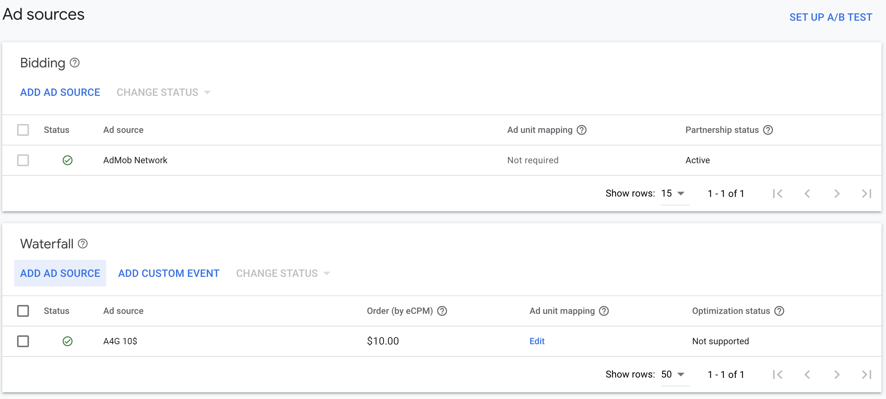
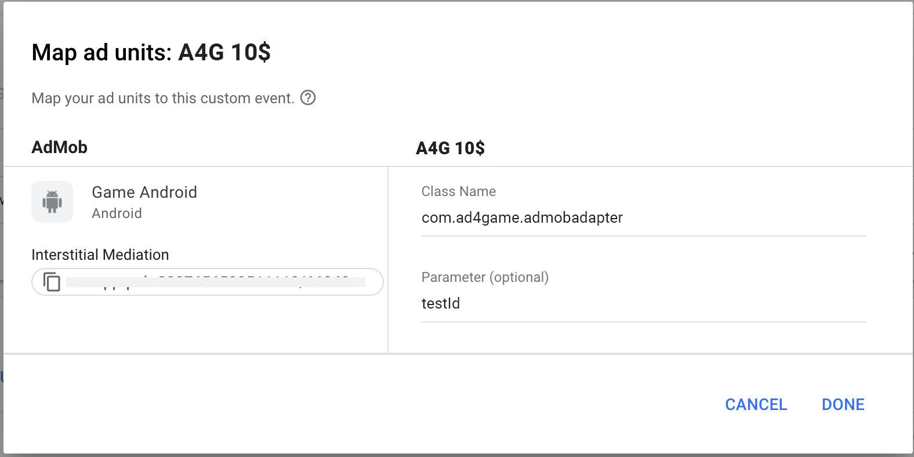

# Integrate Ad4Game with Admob Mediation

**Features**

- [X] Banner
- [X] Interstitial
- [X] Rewarded

**Requirements**

- Google Mobile Ads SDK 24.1.0 or higher
- Use Android Studio 3.2 or higher
- A minSdkVersion of 19 or higher
- A compileSdkVersion of 34 or higher

**Installation**

### Import adapter into your app/game

Add the following implementation dependency with the latest version of the adapter in the app-level `build.gradle` file:

## build.gradle (Project) -OR- in settings.gradle

### build.gradle (Project):

```java
// ...
allprojects {
    buildscript {
        // ...
        repositories {
            // ...
            maven {url "https://github.com/ad4game/a4g-admob/raw/main" }
        }
    }
    repositories {
        // ...
        maven {url "https://github.com/ad4game/a4g-admob/raw/main" }
    }
}
// ...
```

### settings.gradle:

```java
dependencyResolutionManagement {
    repositoriesMode.set(RepositoriesMode.FAIL_ON_PROJECT_REPOS)
    repositories {
        // ...
        maven {url "https://github.com/ad4game/a4g-admob/raw/main" }
    }
}
```

## build.gradle (Module)
⚠️ Use latest version "com.Ad4game:admobmanager:**1.1.8**"
```java
// ...
dependencies {
    implementation fileTree(dir: 'libs', include: ['*.jar'])
    // required google ads
    implementation 'com.google.android.gms:play-services-ads:24.1.0'
    // ⬇ Ad4Game implementation
    implementation 'com.Ad4game:admobmanager:1.1.8'
}
// ...
```

## GMA Next-Gen SDK Support

⚠️ **`com.Ad4game:admobmanager` (1.1.x, including 1.1.8) is NOT compatible with the [GMA Next-Gen SDK](https://developers.google.com/admob/android/next-gen/quick-start) (`com.google.android.libraries.ads.mobile.sdk:ads-mobile-sdk`).**

The adapter requires the legacy Google Mobile Ads SDK (`com.google.android.gms:play-services-ads`) at runtime: it depends on `play-services-ads` and loads ads through legacy classes such as `AdRequest`, `RewardedAd`, `AdManagerInterstitialAd` and `AdManagerAdView`, which the Next-Gen SDK does not include. As a result:

* Adding both SDKs to the same app fails with Gradle **duplicate class** errors.
* Excluding `play-services-ads` fails with R8 **missing class** errors.

If your app uses the legacy Google Mobile Ads SDK, keep using `com.Ad4game:admobmanager` as described above; nothing changes for you.

### Apps using the GMA Next-Gen SDK: `admobmanager-nextgen`

Use the dedicated Next-Gen artifact **instead of** `com.Ad4game:admobmanager`:

| Your app uses | Ad4Game artifact |
|---|---|
| `com.google.android.gms:play-services-ads` (legacy) | `com.Ad4game:admobmanager:1.1.8` |
| `com.google.android.libraries.ads.mobile.sdk:ads-mobile-sdk` (Next-Gen) | `com.Ad4game:admobmanager-nextgen:1.0.0` |

**Requirements:** GMA Next-Gen SDK 1.5.0 or higher, minSdkVersion 24 or higher.

Add the same Maven repository as above, then in the app-level `build.gradle`:

```java
dependencies {
    // GMA Next-Gen SDK (do NOT also add play-services-ads)
    implementation 'com.google.android.libraries.ads.mobile.sdk:ads-mobile-sdk:1.6.0'
    // ⬇ Ad4Game implementation for Next-Gen
    implementation 'com.Ad4game:admobmanager-nextgen:1.0.0'
}
```

The Custom Event class name is unchanged, so your AdMob mediation configuration stays the same:

* Interstitial / Rewarded / Banner / Native: `com.ad4game.admobadapter.AdmobCustomEventManager`

⚠️ Never add both `admobmanager` and `admobmanager-nextgen` to the same app.

## admobmanager-nextgen 1.0.0 (Latest Next-Gen)

**New:**
- ✅ First release for the GMA Next-Gen SDK (`ads-mobile-sdk`). Depends only on `ads-mobile-sdk`, with no `play-services-ads`, so it builds with R8 and has no duplicate classes.
- ✅ Banner, Interstitial, Rewarded and Native, through the same `AdmobCustomEventManager` custom event class.
- ✅ Each ad load completes exactly once (success, failure or 10-second timeout), so the mediation waterfall always moves on correctly.

**Compatibility:**
- GMA Next-Gen SDK 1.5.0+ (tested with 1.6.0)
- Android API 24+

## Version 1.1.8 (Latest)

**Bug Fixes:**
- ✅ Fixed banner ads pausing the host app/game on every refresh (every ~30s) with no matching resume. The banner's `AdListener.onAdImpression()` was incorrectly forwarding `onAdOpened()` on every impression instead of only on a real full-screen overlay open; `onAdOpened()` and `onAdImpression()` are now wired correctly.

**Compatibility:**
- AdMob SDK 24.0.0+
- Android API 21+
- Compile SDK 35+

## Version 1.1.7

**Bug Fixes:**
- ✅ Fixed crash on AdMob SDK 24.9.0 and 25.x caused by removed `onFailure(String)` API
- ✅ All failure callbacks now use the `onFailure(AdError)` API required by modern AdMob
- ✅ Fixed version string reporting (was incorrectly reporting 1.1.5)

**Compatibility:**
- AdMob SDK 24.0.0+
- Android API 21+
- Compile SDK 35+

## Version 1.1.6

**New Features & Improvements:**
- ✅ Enhanced ad loading performance and reliability
- ✅ Improved error handling and diagnostic logging
- ✅ Optimized memory usage during ad requests
- ✅ Better integration with AdMob mediation waterfall
- ✅ Updated SDK compatibility and stability improvements

**Bug Fixes:**
- ✅ Fixed rare crashes during ad initialization
- ✅ Resolved issues with concurrent ad requests
- ✅ Improved handling of network connectivity changes
- ✅ Fixed potential memory leaks in long-running sessions

**Compatibility:**
- AdMob SDK 24.1.0+
- Android API 19+
- Compile SDK 34+

**Usage**
**GDPR Compliance**</br>

If you are not using any Consent Management Platform to handle privacy issues and managing user consent with your own solution, you have to inform admob mediation and mediation partners about the consent. The following code snippet is sample for gdpr consent usage for admob mediation. If you already have the snippet like below you need to add all these extras bundles for the Ad4Game custom event adapter as well.

```java
AdRequest.Builder builder = new AdRequest.Builder();
Bundle extras = new Bundle();
extras.putString("npa", "1");
builder.addNetworkExtrasBundle(AdMobAdapter.class, extras);

// Add this for Ad4Game
builder.addNetworkExtrasBundle(AdmobCustomEventManager.class, extras);
```

**Configure mediation settings for your AdMob ad unit**
You need to add Ad4Game placements provided by the Ad4Game team to the mediation configuration as waterfall ad source for your ad unit.




**Custom Event screen parameters**</br>
**Class Name** : You can use the following parameters depending on the ad unit format of the mediation group.

* Interstitial / Rewarded / Banner / Native: com.ad4game.admobadapter.AdmobCustomEventManager

**Parameter** : Ad4Game Unit ID

## Unity Platform

Use the unity package file located in the <a href="https://github.com/ad4game/a4g-admob/tree/main/unity_package">unity_package</a> folder to include Ad4Game adapters in your app/game:

* `Ad4Game-1.0.3.unitypackage`: Google Mobile Ads Unity plugin with the legacy Android SDK (default).
* `Ad4Game-NextGen-1.0.0.unitypackage`: Google Mobile Ads Unity plugin with the GMA Next-Gen SDK enabled for Android.

See the <a href="https://github.com/ad4game/a4g-admob/tree/main/unity_package">unity_package README</a> to choose a package and for switching steps.

##  iOS

<a href="https://github.com/ad4game/a4g-admob-ios">iOS documentation</a>